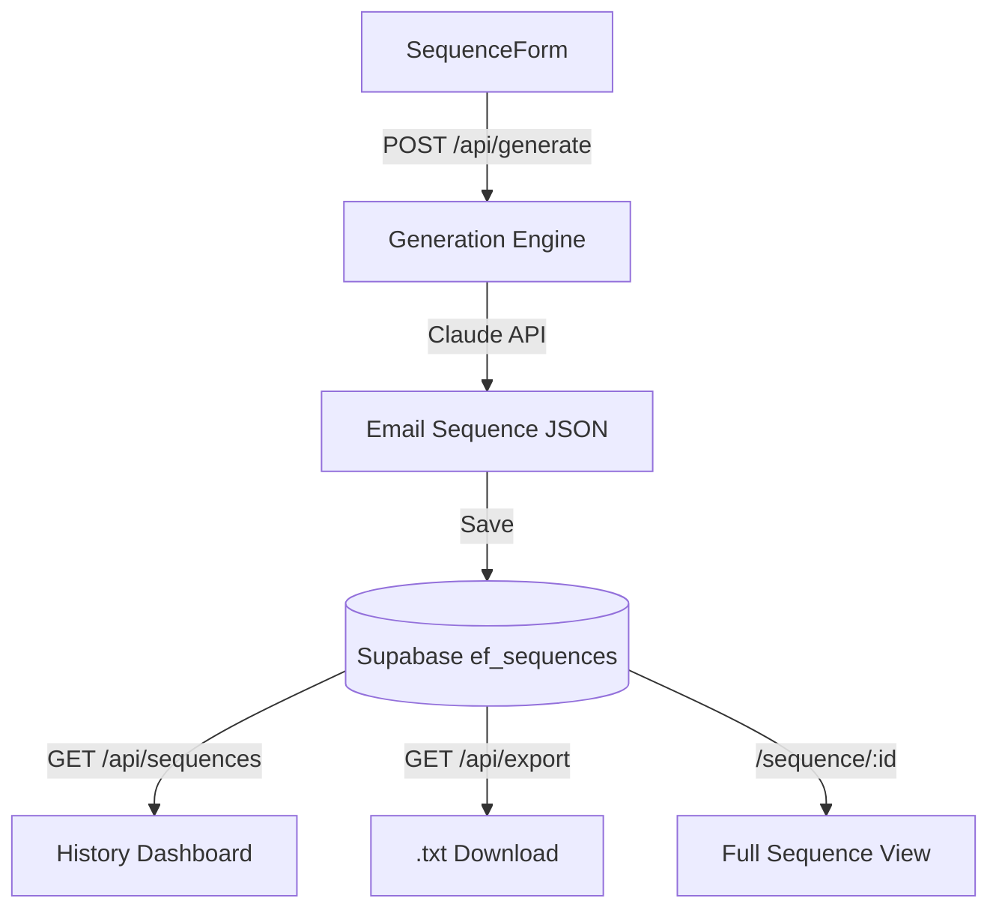

# EmailForge — AI Email Sequence Builder

> **Portfolio project by [Abrar Tajwar Khan](https://github.com/abrartajwar)**  
> Built to demonstrate full-stack AI product development for Fiverr clients.

---

## What It Does

EmailForge generates complete, multi-step email sequences powered by Claude AI. Describe your offer and audience, choose a sequence type, and get a ready-to-send sequence — subject line variants, personalized body copy, and send timing recommendations — in seconds.

```
Input:  Offer + Audience + Type + Tone + Email Count
Output: Complete email sequence (5–7 emails), each with:
        • 2 subject line variants (direct + curiosity)
        • Full personalized body copy (100–200 words)
        • Send timing recommendation
        • Email goal summary
```

---

## Sequence Types

| Type | Use Case |
|------|----------|
| **Cold Outreach** | B2B initial contact + follow-ups |
| **Follow-Up** | After no reply to initial outreach |
| **Welcome Drip** | Onboard new subscribers or trial users |
| **Re-engagement** | Win back cold or inactive leads |
| **Sales Nurture** | Educate and convert warm prospects |

---

## Tech Stack

```
Framework:  Next.js (App Router) + TypeScript
Styling:    Tailwind CSS v4
AI:         Claude (claude-haiku-4-5-20251001) via Anthropic SDK
Database:   Supabase (PostgreSQL)
Deployment: Vercel
```

---

## Architecture



---

## Project Structure

```
src/
├── app/
│   ├── page.tsx                 # Sequence generator (home)
│   ├── history/page.tsx         # History dashboard
│   ├── sequence/[id]/page.tsx   # Full sequence view
│   └── api/
│       ├── generate/route.ts    # Claude generation endpoint
│       ├── sequences/route.ts   # CRUD operations
│       └── export/route.ts      # .txt download
├── components/
│   ├── generator/
│   │   ├── SequenceForm.tsx
│   │   ├── SequenceResults.tsx
│   │   ├── EmailCard.tsx
│   │   └── SubjectLines.tsx
│   ├── history/
│   │   ├── HistoryStats.tsx
│   │   ├── SequenceTable.tsx
│   │   └── FilterBar.tsx
│   └── ui/
│       ├── Button.tsx
│       ├── Card.tsx
│       ├── Badge.tsx
│       └── CopyButton.tsx
└── lib/
    ├── supabase.ts
    ├── claude.ts
    └── export.ts
```

---

## Quick Start

```bash
# Clone and install
git clone https://github.com/abrartajwar/emailforge-ai.git
cd emailforge-ai
npm install

# Configure environment
cp .env.local.example .env.local
# Fill in: NEXT_PUBLIC_SUPABASE_URL, NEXT_PUBLIC_SUPABASE_ANON_KEY,
#          SUPABASE_SERVICE_ROLE_KEY, ANTHROPIC_API_KEY

# Run locally
npm run dev   # → http://localhost:3000
```

---

## Database

Single table in shared Supabase project:

```sql
ef_sequences (
  id               UUID    PRIMARY KEY,
  offer            TEXT    NOT NULL,
  target_audience  TEXT    NOT NULL,
  sequence_type    TEXT    -- cold_outreach | follow_up | welcome_drip | re_engagement | sales_nurture
  tone             TEXT    -- professional | conversational | direct | friendly
  email_count      INTEGER -- 5, 6, or 7
  sender_name      TEXT,
  company_name     TEXT,
  emails           JSONB,  -- Array of email objects
  created_at       TIMESTAMPTZ,
  updated_at       TIMESTAMPTZ
)
```

---

*Built by Abrar Tajwar Khan · EmailForge is part of an AI automation portfolio.*
